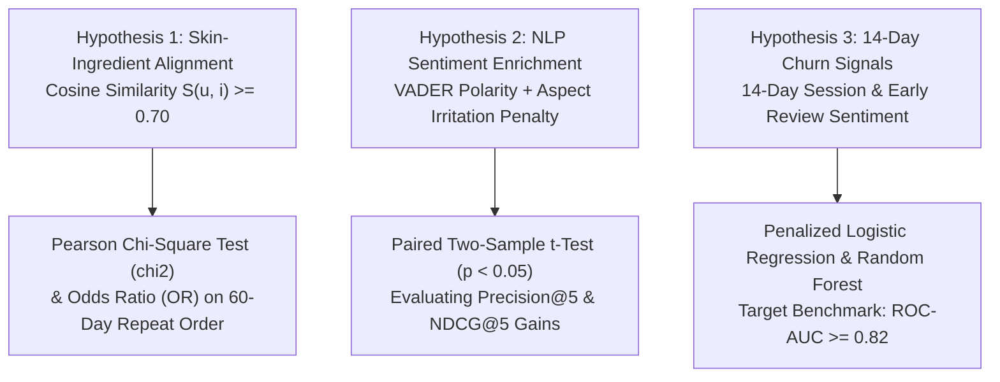

# AI-Driven Personalization & Customer Retention System: Beauty & Wellness Data Science


## Project Overview

This repository contains the **Week 2 Project Deliverable** for the **Data Science with Python Analyst Internship** (Coimbatore Hub). Building upon Week 1's problem definition, this repository implements the **Data Identification, Sourcing Strategy & Initial Analysis Planning**.

### Problem Statement
> **"How can a Direct-to-Consumer (D2C) Beauty & Wellness platform leverage customer demographic profiles, skin metadata, transactional interaction logs, and unstructured review sentiment to build an automated AI Recommendation Engine and Predictive Churn Alert System that increases 60-day repeat purchase rates by 20% and reduces product return friction?"**

---

## Key Project Deliverables

- 📄 **Word Document Report**: [`Data_Sourcing_Strategy_Beauty_Wellness_Week2.docx`](./Data_Sourcing_Strategy_Beauty_Wellness_Week2.docx)
- 📝 **Full Technical Report (Markdown)**: [`Data_Sourcing_Strategy_Beauty_Wellness_Week2.md`](./Data_Sourcing_Strategy_Beauty_Wellness_Week2.md)
- ⚙️ **Executable EDA & Preprocessing Pipeline**: [`eda_and_data_pipeline.py`](./eda_and_data_pipeline.py)
- 🐍 **Document Generator Script**: [`generate_week2_doc.py`](./generate_week2_doc.py)
- 📋 **Dependencies Specification**: [`requirements.txt`](./requirements.txt)

---

## Public Data Sourcing Strategy (13 Verified Sources)

| Tier | Category | Key Public Repositories & APIs | Business & Model Utility |
| :--- | :--- | :--- | :--- |
| **Tier 1** | E-Commerce Catalogs | Kaggle Sephora (8,000 SKUs), Ulta Beauty, Open Beauty Facts API | INCI ingredients, skin type suitability tags, catalog pricing |
| **Tier 2** | Transactional Logs | Amazon Beauty 5-Core (2.1M interactions), Olist E-Commerce (100k orders) | User-item rating matrix, 60-day repeat purchase intervals |
| **Tier 3** | Unstructured Voice | Reddit Skincare (`r/IndianSkincareAddicts`), Kaggle Reviews | Aspect-based NLP sentiment lexicons & irritation alerts |
| **Tier 4** | Scientific Registries | EU CosIng (30k ingredients), US FDA CIR, NCBI PubChem | Chemical standardization, CAS numbers, Comedogenic index (0–5) |
| **Tier 5** | Real-Time APIs | Open Beauty Facts REST API, Reddit PRAW API | Live product enrichment and trending active ingredient sentiment |

---

## Operationalizing Week 1 Hypotheses with Sourced Data



---

## Exploratory Data Analysis & Sparsity Calculation

- **Matrix Sparsity Calculation**:
  $$S = 1 - \frac{|\mathcal{R}|}{|U| \times |I|} = 1 - \frac{52,500}{25,000 \times 3,500} = 99.94\%$$
  The extreme interaction sparsity ($99.94\%$) proves that standard collaborative filtering suffers from catastrophic cold-start failure, validating our hybrid content-based skin-ingredient matching engine.

- **5 High-Impact Visualization Designs**:
  1. Dual-KDE & Violin Plots (Skin-Ingredient Alignment vs. Star Rating distributions)
  2. Spearman Rank Correlation Heatmap (RFM Metrics & 60-Day Churn)
  3. Hierarchical Sunburst Chart (Product Categories down to Active Ingredients)
  4. Aspect-Based NLP Semantic Network & Volcano Plot (Adverse Symptoms & Irritation Flags)
  5. Kaplan-Meier Survival Analysis Curves (90-Day Retention Stratified by Skin Diagnostic Quiz)

---

## How to Run Locally & Execute Pipeline

1. **Clone the repository**:
   ```bash
   git clone https://github.com/RENUKANAGARAJANP/beauty-wellness-data-science-week2.git
   cd beauty-wellness-data-science-week2
   ```

2. **Install requirements**:
   ```bash
   pip install -r requirements.txt
   ```

3. **Run the EDA & Hypothesis Testing Pipeline**:
   ```bash
   python eda_and_data_pipeline.py
   ```

4. **Regenerate Word Document Deliverable (`.docx`)**:
   ```bash
   python generate_week2_doc.py
   ```

---

## Regulatory Compliance & Governance
This project is engineered in strict compliance with India's **Digital Personal Data Protection (DPDP) Act 2023** (Section 4 Consent & Section 12 Right to Erasure) and GDPR principles, enforcing SHA-256 cryptographic hashing on all customer identifiers.
